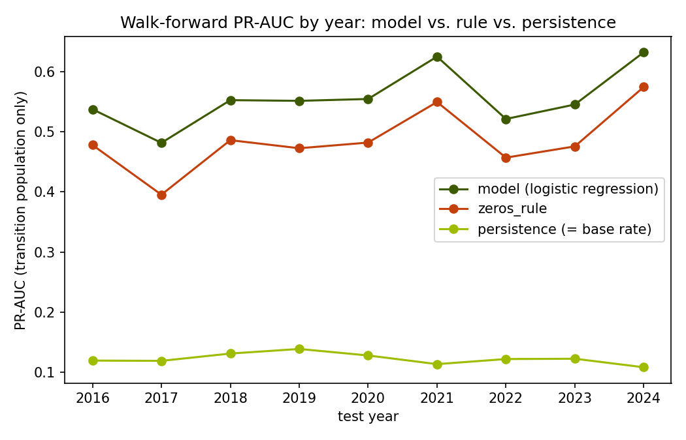
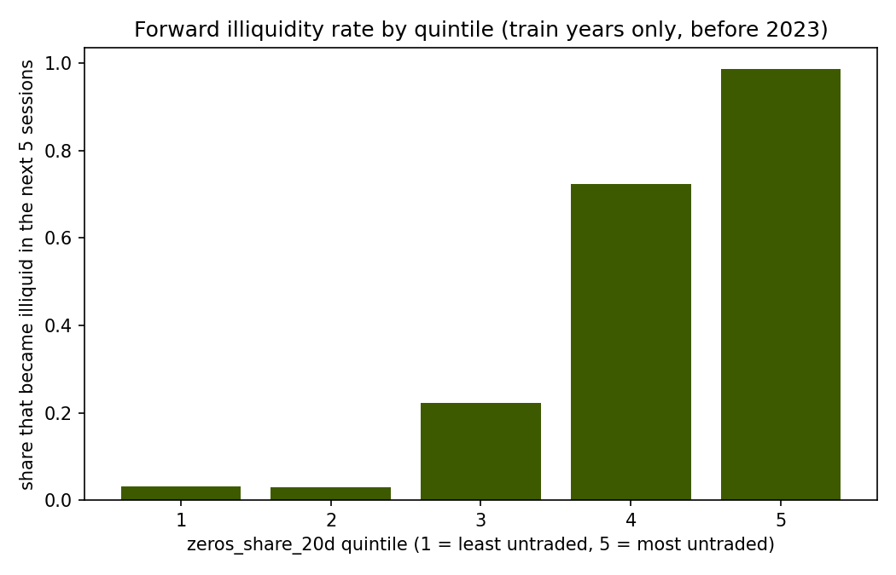

# NSE Liquidity Radar


A reproducible data pipeline on 68 Nairobi Securities Exchange equities, 2013 to October
2024, real daily price and volume data: which stocks are sliding into a thin-trading
regime over the next 5 sessions, and does a model actually beat a simple rule at
predicting it?

Results page: `site/index.html`, built from `outputs/results.json` by `site/build_page.py`.
Not yet deployed to a live URL — that needs a separate go-ahead, see `site/vercel.json`.

## What this project does

An investment desk holding an NSE position asks one practical question before it needs
to exit: can this be sold without moving the market? This project builds the early-warning
signal for that question end to end, from raw public price files to a tested SQL warehouse
to a model, and reports the honest answer rather than the flattering one.

It is built the way this portfolio's other data-engineering project
([kenya-aid-flows](https://github.com/alvenyuka/kenya-aid-flows)) is built: one folder per
stage, small scripts, plain loops, real tests, a page that reads only from the pipeline's
own output file. No dbt, no Airflow, no cloud warehouse — DuckDB and plain numbered SQL
files (with window sizes and thresholds substituted in from `settings.py`, see
`sql/template.py`) show the same SQL/data-engineering skill with nothing extra to maintain.

## Results

The honest headline needs two populations, not one. Most of a session being "illiquid" is
a stock that was **already** illiquid staying that way — a naive persistence guess
("today's regime is tomorrow's") gets 0.72 PR-AUC for free on the full population. The real
question is the harder one: among stocks that are **not** currently illiquid, which ones
turn within 5 sessions?

| Method | PR-AUC, full population | PR-AUC, transition population (not already illiquid) |
|---|---|---|
| Persistence (trailing 5 sessions) | 0.721 | 0.116 *(cannot flag anything by definition)* |
| Rule: untraded ≥50% of last 20 sessions | 0.898 | 0.517 |
| Logistic regression (4 SQL-built features) | **0.914** | **0.584** |

*Test period: 2023-2024, with a 5-session embargo before the split so no training row's
forward label reaches into the test period. 25,418 rows scored (full), 15,881 of those are
the transition population. Base rates: 37.4% (full), 11.6% (transition). Source:
`outputs/results.json` → `baseline`, `model.single_split`.*

**Where the model actually adds value, and where it doesn't.** At the rule's own flag count
(25 rows in 2023-2024), the model's top-ranked rows are identical to the rule's — same
precision (84%), same recall (1.1%). The model's higher PR-AUC comes entirely from ranking
better *below* that cutoff, not from beating the rule at the operating point a desk would
use today. On the transition population, the model's ranking also beats the rule's **in
every one of 9 overlapping test years**, 2016 through 2024, refit on an expanding window
each time — a stability check across years of the same pair of scorers, not nine
independent replications, but still not one lucky split:



The quintile chart below (computed on **train years only**, before 2023 — in-sample, shown
as a feature-selection check, not held-out validation; the walk-forward chart above is the
held-out evidence) shows `zeros_share_20d` separating forward risk cleanly on its own:



The logistic regression's standardised coefficients are `avg_volume_20d` -7.51,
`zeros_share_20d` +2.75, `volatility_20d` -0.018, `volume_zscore_60d` -0.007 — the first two
features carry essentially all of the weight, the last two add almost nothing. Reading
`avg_volume_20d`'s larger magnitude as "the more important feature" would be a mistake,
though: the two are only weakly correlated (-0.17 on train years, checked directly), but
`avg_volume_20d` is heavily right-skewed (median 18,325, 99th percentile 8.56 million)
while `zeros_share_20d` is bounded to [0, 1], and a standardised coefficient on a
heavy-tailed feature can be inflated by that skew relative to a bounded one. Which of the
two actually drives more of the separation shown in the quintile chart is left as an open
question, not resolved here. A simpler two-feature model would likely perform about as
well either way — also left open.

## How I built it

1. **Look at the raw data.** Four public datasets, one author (Barack Wanjawa, University
   of Nairobi), one 13-column schema, CC BY 4.0, downloaded with no login from Mendeley
   Data's bulk-zip API: 2013-2020, 2021, 2022, 2023-Oct 2024. A gap the old planning notes
   flagged ("no verified source for 2021-2022") turned out to be stale — the same author's
   series already covers it.
2. **Clean it.** Real schema drift between eras (`DATE`/`CODE` become `Date`/`Code`;
   `Adjust` becomes `Adjusted Price`), a date format that changes mid-series
   (`2-Jan-13` vs `03-Jan-2023`), `Volume` written with thousands commas, `Change%` written
   as an **unsigned magnitude** (confirmed by comparing it against a computed percentage —
   0 mismatches once the sign is handled correctly instead of 59,413 false ones), market
   indices mixed into the price files (`^NASI`, `^N20I`, …, excluded: an index has no
   comparable single-instrument volume), and 7 sector rows with no company name dropped
   (4 blank trailing rows in two older files, plus 3 in the 2023-2024 file where a section
   label landed in the `Stock_code` column instead of its own row — a source authoring bug,
   found by reading the raw file).
3. **Warehouse it.** DuckDB, loaded from the cleaned parquet files.
4. **Build the SQL models.** The step that mattered most: a **dense per-stock session
   grid** before any rolling window. The source never once writes a literal volume of `0` —
   an untraded day is either a row with `volume = "-"` or, for some stocks, **no row at
   all**. MSC alone is missing 552 of its own 2,941 bounded sessions. A window function over
   the raw sparse table would have silently stretched "the next 5 sessions" across however
   many calendar gaps happened to be in the way. The grid is bounded to each stock's own
   first/last observed date, so a delisted name does not read as "illiquid forever."
   Features and both labels then use `ROWS BETWEEN n PRECEDING/FOLLOWING`, never a date
   range, on that dense grid.
5. **Check it.** 8 SQL checks that must return zero rows: no duplicate (stock, session)
   rows, the grid never leaves a stock's own listed life, the forward label is `NULL` in
   exactly a stock's last 5 sessions and nowhere else, the trailing flag is `NULL` in
   exactly the first 4, no negative or fractional volume, dates in range, every price code
   resolves to a sector. A separate hand-built test (`tests/test_label_logic.py`) computes
   the two label windows on a tiny 14-row sequence with a known answer and checks the real
   SQL against it — the single most important correctness test in the project.
6. **Baseline it.** A naive persistence guess and a fixed rule (untraded ≥50% of the last 20
   sessions), scored on the test period only.
7. **Model it.** Logistic regression, scaled and fit on training years only, compared to
   the baselines by matching flag counts rather than a fixed 0.5 cutoff (meaningless on an
   11% positive rate).
8. **Report, chart, and build the page.** Every figure on the README and the site reads from
   `outputs/results.json`.

## Problems I hit

- **The persistence trap.** The first thing any model here can "discover" is that a dead
  stock stays dead. Reporting only the full-population PR-AUC would have been quietly
  dishonest; splitting out the transition population was the fix, worked out before writing
  any model code by checking the plan against likely failure modes first (see
  `docs/METHODOLOGY.md`'s "Decisions" section).
- **`0/0` is `NaN`, not `NULL`.** A 60+ session stretch of constant (zero) volume makes the
  60-day z-score's standard deviation exactly 0 — DuckDB returns a floating-point `NaN` for
  that division, which sails straight past every `IS NOT NULL` filter. Found by scikit-learn
  refusing to fit, not by inspection. Fixed with `NULLIF(stddev, 0)`.
- **`Change%` has no sign.** The source writes it as an unsigned magnitude, so a naive
  signed comparison against a computed percentage disagreed on 59,413 of 126,054 rows —
  looked like a major data-quality problem until a handful of rows by eye showed the
  pattern (`Change` = -4.5, `Change%` = "6.25%", no minus sign).
- **77 stock codes were not the ~60-64 expected.** The combined price files carry 77
  distinct codes, not 68. 9 of those are market indices (`^NASI`, `^N20I`, `^FNK25`, …)
  mixed into the same files as real equities, with their own row in the sector files'
  "Indices" category — excluded once found (77 - 9 = 68), not averaged away.

## Data

[Nairobi Securities Exchange All Stocks Prices](https://data.mendeley.com/datasets/73rb78pmzw/2),
Barack Wanjawa, University of Nairobi, via Mendeley Data (four linked datasets covering
2013-2020, 2021, 2022 and 2023-2024), CC BY 4.0. Scraped from live.mystocks.co.ke, licensed
by the NSE. Not redistributed here — `ingest/fetch_mendeley.py` downloads it fresh into a
gitignored `data/`, and `data/raw/manifest.json` records the exact source URL and a sha256
of every file fetched.

This is a **frozen historical archive**, last updated November 2024, not a live feed — there
is deliberately no scheduled-refresh workflow, unlike `kenya-aid-flows` (this portfolio's
other data-engineering project), which pulls from a live API on a monthly schedule.

## Limits

- Returns are computed from the raw close, which the source **echoes unchanged** on an
  untraded day rather than leaving blank. That understates true 20-day return volatility on
  the thinnest names — a day with no trade is not really a zero-return day, it is a missing
  one. Stated here rather than left for a reader to catch.
- `volume_zscore_60d` is genuinely undefined (not computed, not imputed) for a stock with
  zero volume for 60 straight sessions — a real state in this market, not a bug.
- Sector is shown for grouping only on the site; it is never a model feature, since it is
  static and would mostly memorise which names are already known to be thin rather than
  generalise.
- The standardised coefficients describe association within this sample, not a causal claim.
- The "days to exit" column on the results page is an illustrative 20%-participation
  execution rule, not a market-impact model.
- Kenya Power preference shares (`KPLC-P4`, `KPLC-P7`) are kept as separate listed
  instruments, not merged with the ordinary `KPLC` line.

## How to run

```bash
pip install -r requirements.txt
py -3 run_all.py            # every stage, in order, ~25s with cached downloads
py -3 -m pytest -q          # 21 hermetic tests, no live download needed
py -3 checks/run_checks.py  # the 8 SQL correctness checks on their own
```

Each stage can also be run on its own (`py -3 clean/run_clean.py`, `py -3 sql/run_sql.py`,
…) — see the docstring at the top of each script.

## Project structure

```
ingest/      fetch_mendeley.py      downloads the 4 CSV sets + sector files, writes manifest.json
clean/       clean_prices.py, clean_sectors.py, common.py, rule_log.py
warehouse/   build_db.py            loads the cleaned data into DuckDB
sql/         01-05 numbered .sql,   sessions, dense grid, features, labels, marts;
             template.py            template.py substitutes settings.py's constants into the .sql files' {{TOKENS}}
checks/      01-08 numbered .sql    each one a query that must return zero rows
baseline/    rule_of_thumb.py       persistence and a fixed zeros_share_20d rule, scored on the test period
model/       train_model.py         logistic regression, single split + walk-forward by year
report/      make_results.py, make_figures.py, rounding.py
site/        build_page.py          builds site/index.html from outputs/results.json
tests/       21 hermetic pytest tests, including the hand-built label-logic cross-check
settings.py  every constant (window sizes, thresholds, split year) in one place
run_all.py   runs every stage above in order
```

## License

MIT (code). The underlying NSE price data is CC BY 4.0, attributed above.
